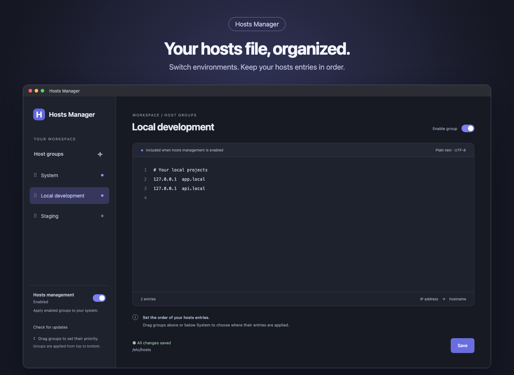

<div align="center">


# Hosts Manager

**Your hosts file, organized.**

Manage hosts entries in groups, switch environments instantly, and edit your system hosts file from one desktop app.
Available for macOS, Windows, and Linux, with light and dark themes that follow your system.

[Download](https://github.com/Back-At-You-Inc/hosts-manager/releases/latest) · [Features](#features) · [Getting started](#using-the-app) · [Development](#development)

[](https://github.com/Back-At-You-Inc/hosts-manager/actions/workflows/release.yml)
[](https://github.com/Back-At-You-Inc/hosts-manager/actions/workflows/tests.yml)
[](LICENSE)
[](https://github.com/Back-At-You-Inc/hosts-manager/releases/latest)



</div>

## Features

- Create groups and rename their titles inline.
- Drag groups to reorder them, including above or below **System**. A drop indicator shows the insertion point. Keyboard users can reorder with **Alt + Up/Down**.
- Enable or disable groups immediately, using their saved entries.
- Edit **System** directly and save changes to your main hosts file.
- Keep drafts while switching groups. Unsaved edits show a red sidebar dot and a badge beside the title.
- Manage hosts globally from the sidebar or system tray.
- Check GitHub Releases for newer versions and open the download page.

## Installation

Download the latest version from the [GitHub Releases page](https://github.com/Back-At-You-Inc/hosts-manager/releases).

| Platform | Architecture | Downloads |
| --- | --- | --- |
| macOS | Apple Silicon / ARM64 | DMG or ZIP |
| Windows | x64 | `-installer.exe` (setup wizard) or `-app.zip` (portable app) |
| Linux | x64 | DEB, RPM, install script, AppImage, or tar.gz |

**macOS:** Open the DMG and move **Hosts Manager.app** to Applications, or extract the ZIP. Releases are not Developer ID signed or notarized, so macOS may require approval in **System Settings → Privacy & Security**. The first protected hosts update asks to install an administrator helper; subsequent updates use that helper without repeating the password prompt.

**Windows:** Run `Hosts-Manager-<version>-win-x64-installer.exe` for the setup wizard. For the portable app, extract the complete `Hosts-Manager-<version>-win-x64-app.zip` and launch **Hosts Manager.exe**. Releases are not Authenticode signed, so Windows may show an unknown-publisher or SmartScreen warning. Protected hosts updates request permission through UAC.

**Linux:** Use the [Linux installer](docs/linux-install.md) to download, verify, and set up the app with an application-menu entry. Alternatively, make the AppImage executable and run it, or extract the tar.gz and run `hosts-manager`. A desktop environment is required. Protected hosts updates need PolicyKit (`pkexec`) and a desktop authentication agent. System tray availability depends on the desktop environment.

For macOS ARM64, a [Homebrew cask and installation instructions](docs/homebrew.md) are prepared for public launch. Stable releases update the cask automatically; unauthenticated installation requires this repository to be public.

Releases upload packaged apps, the Linux install script, and checksums. GitHub also automatically displays source-code archives, which cannot be hidden; use the **App downloads** links in the release notes to install the app.

### Linux packages

Download the package matching your distribution from [Releases](https://github.com/Back-At-You-Inc/hosts-manager/releases/latest), then install it from your downloads directory. Replace `<version>` with the downloaded version.

**Ubuntu, Debian, Linux Mint:**

```sh
sudo apt install ./Hosts-Manager-<version>-linux-x64.deb
```

**Fedora:**

```sh
sudo dnf install ./Hosts-Manager-<version>-linux-x64.rpm
```

The package manager installs the app, application-menu entry, and declared dependencies. Launch **Hosts Manager** from the menu. Downloads are unsigned; only install packages from the official release. A desktop authentication agent and PolicyKit are needed for protected hosts updates.

For upgrades, save drafts, quit through the tray, and install the newer package with the same command. To uninstall, use `sudo apt remove hosts-manager` or `sudo dnf remove hosts-manager`. Saved groups and existing hosts entries remain; disable **Hosts management** first if you want managed entries removed.

These are downloadable packages. We do not currently host an APT or DNF repository, so system updates will not automatically download new app releases. Use the app's update notification or the release page to download upgrades. Avoid installing a native package and the per-user script version together.

### Linux install

Requirements: Linux x64, Python 3.9 or newer, `curl`, and a graphical desktop. Once this repository is public and the installer release is available:

```sh
curl -fL --output install-linux.py https://github.com/Back-At-You-Inc/hosts-manager/releases/latest/download/install-linux.py
python3 install-linux.py
```

Run as your desktop user **without sudo**. You can review the downloaded script before running it. It verifies the release archive checksum, installs the app under `~/.local/share/hosts-manager-app` (or `$XDG_DATA_HOME/hosts-manager-app`), adds a **Hosts Manager** application-menu entry, and creates `~/.local/bin/hosts-manager`. Launch from the application menu or run:

```sh
~/.local/bin/hosts-manager
```

Protected hosts-file changes require PolicyKit (`pkexec`) and a desktop authentication agent. Install missing system dependencies through your distribution's package manager. The installer itself does not modify the hosts file.

**Upgrade:** save drafts, quit through the tray, then download and run the installer again. Saved groups remain in place.

**Uninstall:**

```sh
python3 install-linux.py --uninstall
```

Uninstall preserves saved groups and existing hosts entries. To remove managed entries too, turn **Hosts management** off before uninstalling. See [Linux installer details](docs/linux-install.md) for specific-version installation and runtime requirements.

The repository is currently private, so anonymous downloads are not yet available.

## Using the app

1. Create a group with the **+** button, then enter hosts entries in its text box.
2. Click **Save** to save its text. If the group and global hosts management are enabled, the saved entries also update the hosts file.
3. Toggle a group on or off to update its inclusion immediately. Toggles use saved text and preserve unsaved drafts.
4. Drag groups into the desired order. Enabled entries are written in that order, before or after the **System** entries according to their position.
5. Select **System** to edit the main hosts entries. Its **Save** button writes directly to the hosts file while preserving enabled group entries. System cannot be deleted or dragged.

Only text edits require **Save**. Group names, order, enabled state, and deletion save automatically. Disabling **Hosts management** removes the app's managed sections and preserves the system entries.

Example entries:

```text
# Local development
127.0.0.1 app.local api.local
::1 ipv6.local
```

Entries require an IPv4 or IPv6 address followed by one or more hostnames. Comments and blank lines are supported. Duplicate hostname resolution and DNS/application caching depend on the operating system.

Text drafts remain in memory while you navigate between groups, but do not survive quitting. Save them before closing the app permanently or installing an update. Closing the window normally keeps the app in the tray; use **Quit** from the tray to exit. Quitting leaves the current hosts entries in place.

## Hosts files and permissions

The app updates `/etc/hosts` on macOS/Linux or `%SystemRoot%\System32\drivers\etc\hosts` on Windows. Before changing the file, it writes a backup beside it named `hosts.hosts-manager.bak`.

Group entries use marked **Hosts Manager** sections. Group updates preserve entries outside those sections. Explicit System saves change the system entries after validation; stale edits are rejected rather than overwriting a newer external change. Launching the app alone does not modify your hosts file.

The Electron interface runs without administrator privileges. Only protected file updates use elevated access. On macOS, a root-owned native helper is installed for the account that approved it and can update only `/etc/hosts`. It checks peer credentials, validates requests, rejects stale snapshots, creates a backup, and writes changes atomically. Other processes running as that authorized account share this hosts-file capability. A changed helper version requests permission to upgrade on its next protected update.

Use **Remove administrator helper…** in the macOS tray menu to uninstall the helper. Removal requires administrator approval and leaves the hosts file unchanged. It will be installed again if a later protected update needs it.

Saved workspace settings are kept in Electron's application-data directory under `hosts-manager`. Updates retain that location. Cancelled or failed file writes display an error; editor drafts remain available when a System save fails.

## Development

Requirements: **Node.js 22 or later**, npm, and a desktop environment. On macOS, install the Xcode command-line tools to compile the native helper.

```sh
git clone https://github.com/Back-At-You-Inc/hosts-manager.git
cd hosts-manager
npm ci
npm start
```

`npm start` builds the renderer, Electron code, helper, and icons before launching the app. On macOS, it uses a locally ad-hoc-signed development bundle to display the **Hosts Manager** name and H icon in the Dock.

```sh
npm run check   # TypeScript checks
npm test        # Hosts, permissions, update checks, and native helper tests
npm run build   # Build without launching
```

Automated tests use mocks and temporary files; they do not change the real hosts file or trigger administrator prompts. Permission dialogs and installed helper behavior need testing on the target operating system.

`preview/standalone.html` is a sample browser preview with mock IPC. Its controls never modify the real hosts file; use `npm start` for the desktop app.

## Packaging

Packaging uses **electron-builder**, installed separately from application dependencies. An internet connection is needed to install build tools and download platform runtimes.

```sh
npm run setup:packaging
```

Run the command for the target platform, preferably on that operating system:

```sh
npm run package -- mac
npm run package -- windows
npm run package -- linux
```

Packages are written to `release/`. macOS ARM64 packaging must run on an ARM64 Mac so the helper matches the app architecture. The release configuration includes the H icon, app identity, and Mac helper. Releases require no paid signing credentials and remain manually installed.

## Updates and releases

Packaged builds check the public GitHub release repository on startup and every six hours. **Check for updates** in the sidebar checks manually. A newer stable release with a compatible download shows **Update available**, with a **Download update** button that opens the release page. Downloading and replacing the app remain manual.

`release-config.json` sets the public release repository. Packaging can override it using `HOSTS_MANAGER_RELEASE_REPOSITORY=owner/repository`. GitHub Actions configures it from the current repository automatically. No GitHub token is embedded in the app; private release repositories are not supported.

The independent [Tests workflow](.github/workflows/tests.yml) runs TypeScript checks and regression tests on macOS, Windows, and Linux. The release version badge refreshes after a successful stable release.

Every branch push runs the [build and release workflow](.github/workflows/release.yml). Each platform runs tests before packaging. A release is published automatically only after all three platform builds succeed and all eight app packages, the Linux installer, and SHA-256 checksums have been uploaded. Failed tests, builds, or uploads prevent publication. No manual publish step or version tag is required.

The workflow generates a version from the manifest's major/minor version and its patch number plus the GitHub workflow run number. For example, a base of `0.1.1` and run number `12` produces `0.1.13` on `master`. Other branches publish prereleases such as `0.1.13-ci.12`, which are excluded from normal app update notifications. The computed version is embedded in the packages and used in artifact filenames and the release tag. Manifest changes remain inside the build; CI does not commit them back to the branch.

Both branch pushes and manual workflow runs publish successful builds. Explicit `v*` tag pushes remain supported when the tag matches the manifest version. Rebuilding an already-published version refuses to replace its existing downloads. The release tag targets the exact commit tested by that workflow run.

GitHub Actions also retains platform artifacts for 7 days. The workflow uses GitHub's built-in token to create the release and upload downloads. Signing secrets are not required. All three hosted platform builds have passed; installed app behavior still requires validation on each operating system. The workflows are self-contained in this repository and use GitHub's official actions plus local build scripts. They do not inherit organization secrets or send external build notifications.

Before installing an update, save drafts and fully quit the app through the tray. Replacing the app preserves saved groups and does not itself change the hosts file.

## Project structure

| Path | Purpose |
| --- | --- |
| `renderer/` | React interface and theme styles |
| `electron/` | Desktop lifecycle, IPC, permissions, hosts operations, and update checks |
| `shared/types.ts` | Shared TypeScript types |
| `native/macos/` | Native macOS administrator helper |
| `scripts/` | Build, development launch, packaging, and release scripts |
| `test/` | Automated regression tests |
| `assets/icons/` | H branding assets |
| `electron-builder.cjs` | Platform packaging configuration |

Vite bundles the renderer into `dist/renderer`. TypeScript compiles Electron code into `dist/electron`, using CommonJS output for the sandboxed preload. Build tooling also uses JavaScript scripts and a CommonJS builder configuration.

## Contributing

See [CONTRIBUTING.md](CONTRIBUTING.md) for development and pull-request guidance, and [SECURITY.md](SECURITY.md) for vulnerability reporting. Public launch preparation is tracked in [docs/public-launch.md](docs/public-launch.md). The current license remains in effect until the launch license is selected.

## License

Hosts Manager is proprietary software owned by Back At You, Inc. Official compiled releases are free to use for personal and internal business purposes. Modifying or redistributing our code, creating derivative products, and public mirroring require written permission, except where applicable law or hosting-service terms provide otherwise. Viewing available source does not make this an open-source project.

See [LICENSE](LICENSE) for the full terms. Third-party components retain their own licenses; see [THIRD_PARTY_NOTICES.txt](THIRD_PARTY_NOTICES.txt) and the notices bundled with Electron.
